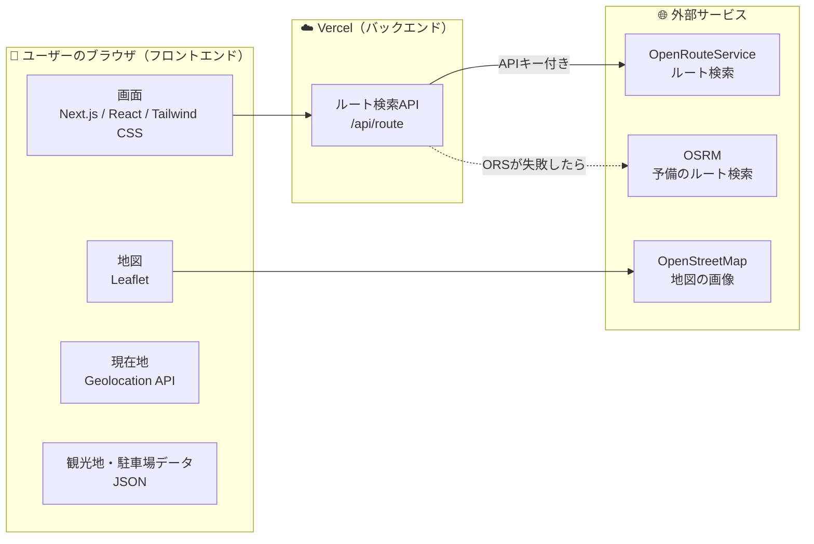
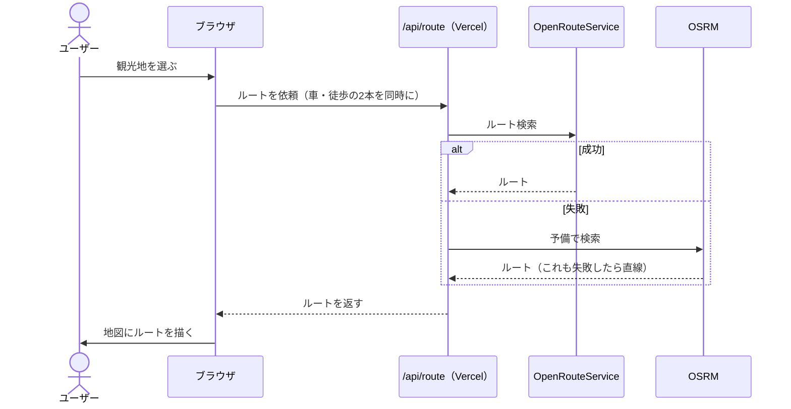
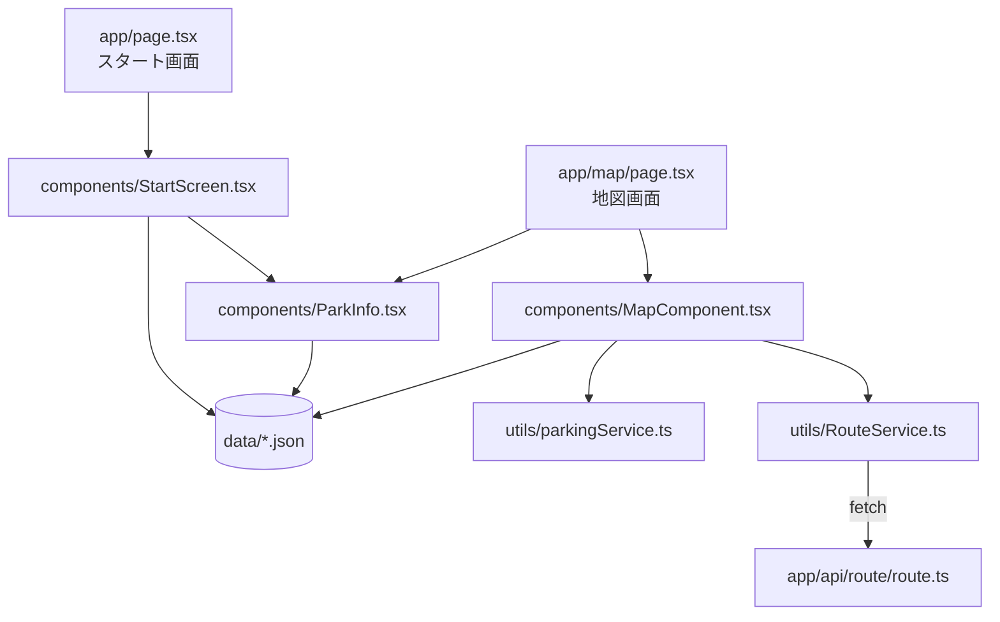

# 🧭 長崎ナビ 開発ガイド

継続開発に参加するメンバー向けのガイドです。
「このアプリがどう動いているか」「どこに何を書けばいいか」を、開発に慣れていない人でも分かるようにまとめています。

- [1. まず知っておきたい用語](#1-まず知っておきたい用語)
- [2. 技術構成](#2-技術構成)
- [3. ルート検索の流れ](#3-ルート検索の流れ)
- [4. ディレクトリ構成](#4-ディレクトリ構成)
- [5. ファイル配置のルール](#5-ファイル配置のルール)
- [6. よくある作業と触るファイル](#6-よくある作業と触るファイル)
- [7. 開発環境の準備](#7-開発環境の準備)

---

## 1. まず知っておきたい用語

| 用語 | 意味 |
| --- | --- |
| フロントエンド（FE） | ユーザーのスマホやPCの**ブラウザの中で動く部分**。画面の表示や、ボタンを押したときの動きを担当する |
| バックエンド（BE） | **サーバーで動く部分**。APIキーのような、ユーザーに見せてはいけない情報を扱う |
| API | プログラム同士がデータをやり取りする「窓口」。このアプリでは「2地点を送ると、ルートが返ってくる」窓口を使っている |
| APIキー | 外部サービスのAPIを使うための「合言葉」。漏れると他人に悪用されるので、ブラウザ側のコードには絶対に書かない |
| フォールバック | 1つ目の方法が失敗したときに、次の方法を試す仕組み |
| デプロイ | 作ったアプリをインターネット上で公開すること。このアプリは Vercel にデプロイしている |

---

## 2. 技術構成

### 全体図（アーキテクチャ図）

アプリは「ユーザーのブラウザ」「Vercel のサーバー」「外部サービス」の3か所に分かれて動いています。



図のポイントは次の3つです。

- **ルート検索だけは、必ずバックエンド（`/api/route`）を通します。** OpenRouteService を使うにはAPIキーが必要で、ブラウザから直接呼ぶとキーが丸見えになるためです。
- **観光地・駐車場のデータは、サーバーから取得していません。** JSONファイルが画面のコードに組み込まれて、最初からブラウザに届いています。データベース（DB）は使っていません。
- **地図の画像は、ブラウザが OpenStreetMap から直接取得しています。** APIキーが不要なので、バックエンドを通す必要がありません。

### フロントエンド

| 技術 | 何に使っているか |
| --- | --- |
| Next.js 16（App Router） | アプリ全体の土台。ファイルを置いた場所がそのまま画面のURLになる |
| React 19 | 画面を「部品（コンポーネント）」に分けて作る仕組み |
| TypeScript | 型のある JavaScript。書き間違いを実行前に見つけられる |
| Tailwind CSS v4 | `className="text-blue-600"` のように、クラス名で見た目を指定する。一部の部品は普通の CSS ファイルも使っている |
| Leaflet / React Leaflet | 地図の表示、ルートの線やマーカーの描画 |
| Geolocation API | ブラウザの機能。ユーザーの現在地を取得する |

### バックエンド

| 技術 | 何に使っているか |
| --- | --- |
| Next.js Route Handler | `src/app/api/route/route.ts` に書いたコードが、サーバーで動く API（`POST /api/route`）になる |
| Vercel | アプリの公開先（デプロイ先）。フロントエンドもバックエンドもまとめてここで動く |

### 外部サービス

| サービス | 何に使っているか |
| --- | --- |
| OpenRouteService（ORS） | メインのルート検索。車は大型車向けの設定（`driving-hgv`）を使い、大通りを優先したルートを出す。APIキーが必要 |
| OSRM | ORS が失敗したときの予備のルート検索。APIキー不要 |
| OpenStreetMap | 地図の画像（タイル） |

### 開発ツール

| ツール | 何に使っているか |
| --- | --- |
| ESLint | コードの書き方をチェックする（`npm run lint`） |
| cloudflared | 手元で動かしているアプリを一時的にインターネットに公開し、スマホから動作確認する（`npm run tunnel`） |

---

## 3. ルート検索の流れ

ユーザーが観光地を選んでから、地図にルートが表示されるまでの流れです。



ブラウザは「現在地 → 駐車場（車）」と「駐車場 → 観光地（徒歩）」の2本のルートを、同時に `/api/route` へ依頼します。

`/api/route` の中では、次の順にフォールバックします。どれも失敗したときは、2地点を直線で結んで表示します。アプリが真っ白にならないようにするためです。

| ルート | 1番目 | 2番目 | 3番目 | 最後 |
| --- | --- | --- | --- | --- |
| 車 | ORS 大通り優先（`driving-hgv`） | ORS 通常の車（`driving-car`） | OSRM | 直線 |
| 徒歩 | ORS 徒歩（`foot-walking`） | OSRM | — | 直線 |

---

## 4. ディレクトリ構成

```
src/
├── app/                    # 画面とAPI（Next.js App Router）
│   ├── page.tsx            # スタート画面（URL: /）
│   ├── map/page.tsx        # 地図画面（URL: /map）
│   ├── api/route/route.ts  # ルート検索API（バックエンド）
│   ├── layout.tsx          # 全画面に共通の枠
│   └── globals.css         # 全画面に共通のスタイル
├── components/             # 画面の部品
│   ├── StartScreen.tsx     # 観光地の選択・現在地の取得
│   ├── MapComponent.tsx    # 地図本体・ルートの描画
│   └── ParkInfo.tsx        # 駐車場の一覧モーダル
├── data/                   # アプリで使うデータ（JSON）
│   ├── spot.json           # 観光地
│   ├── parking.json        # 駐車場
│   └── intersection.json   # 注意交差点
└── utils/                  # 画面を持たない処理
    ├── RouteService.ts     # /api/route を呼ぶ
    └── parkingService.ts   # JSONから観光地・駐車場を探す
public/                     # 画像・アイコン
```

※ 部品専用の CSS ファイル（`MapComponent.css` など）は省略しています。

### ファイルのつながり

矢印は「使っている」という意味です。たとえば、地図画面を直したいときは `app/map/page.tsx` から矢印をたどると、関係するファイルが分かります。



スタート画面で観光地を選ぶと、`/map?startLat=…&startLng=…&spotId=…` のように、現在地と観光地の ID を URL に付けて地図画面へ移動します。

---

## 5. ファイル配置のルール

| ルール | 理由 |
| --- | --- |
| `src/app/` には、画面（`page.tsx`）とAPIだけを置く。部品は `src/components/` へ | `app/` を見るだけで、画面とURLの一覧が分かるようにするため |
| 外部のルート検索APIを呼ぶのは `src/app/api/route/route.ts` だけ | APIキーをブラウザに出さないため |
| 部品専用の CSS は、部品と同じ名前で横に置く（例：`MapComponent.tsx` と `MapComponent.css`） | 部品とその見た目を、セットで見つけられるようにするため |
| 地図を使う部品は `next/dynamic` の `ssr: false` で読み込む（`src/app/map/page.tsx` を参照） | Leaflet はブラウザでしか動かず、サーバーで先に画面を作ろうとするとエラーになるため |
| 観光地・駐車場・交差点のデータは `src/data/*.json` で管理する | データを1か所にまとめて、コードを触らずに追加できるようにするため |
| import は相対パス（`../../components/...`）で書く | 既存のコードに合わせて、書き方をそろえるため |
| 使わなくなった画像やファイルは削除する | どれが現役のファイルか迷わないようにするため |

---

## 6. よくある作業と触るファイル

| やりたいこと | 触るファイル |
| --- | --- |
| 観光地を追加する | `src/data/spot.json` |
| 駐車場を追加する | `src/data/parking.json`（`spot_key` に、対応する観光地の `id` を入れる） |
| 注意交差点を追加する | `src/data/intersection.json` |
| スタート画面の見た目を変える | `src/components/StartScreen.tsx`、`StartScreen.css` |
| 地図の見た目を変える | `src/components/MapComponent.tsx`、`MapComponent.css` |
| 駐車場の一覧モーダルを変える | `src/components/ParkInfo.tsx` |
| ルートの探し方を変える | `src/app/api/route/route.ts` |
| 新しい画面を追加する | `src/app/<画面名>/page.tsx` を作る（フォルダ名がそのままURLになる） |

---

## 7. 開発環境の準備

1. パッケージをインストールします。

   ```bash
   npm install
   ```

2. `.env.example` をコピーして `.env.local` を作り、OpenRouteService のAPIキーを入れます。キーは [OpenRouteService](https://openrouteservice.org/) に登録すると無料で発行できます。

   ```
   ORS_API_KEY=発行したキー
   ```

   `.env.local` は Git に含まれない設定になっています。キーをコードやコミットに書かないでください。
   キーがなくても OSRM で動きますが、大通り優先のルートは出なくなります。

3. 開発サーバーを起動し、ブラウザで http://localhost:3000 を開きます。

   ```bash
   npm run dev
   ```

4. スマホで確認したいときは、`npm run dev` を起動したまま、別のターミナルで次を実行します。表示された `https://〜.trycloudflare.com` のURLをスマホで開きます。

   ```bash
   npm run tunnel
   ```

   現在地の取得は、安全な接続（HTTPS）でしか動きません。スマホから同じWi-Fiで `http://` のアドレスを開くと、現在地が取れないので、このコマンドを使います。

コミットする前に `npm run lint` でチェックしておきましょう。
